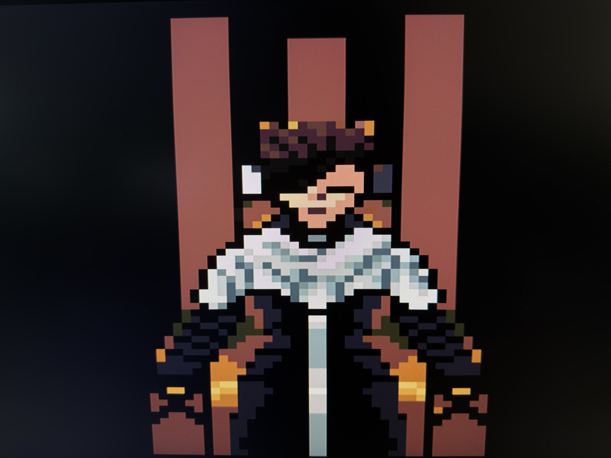
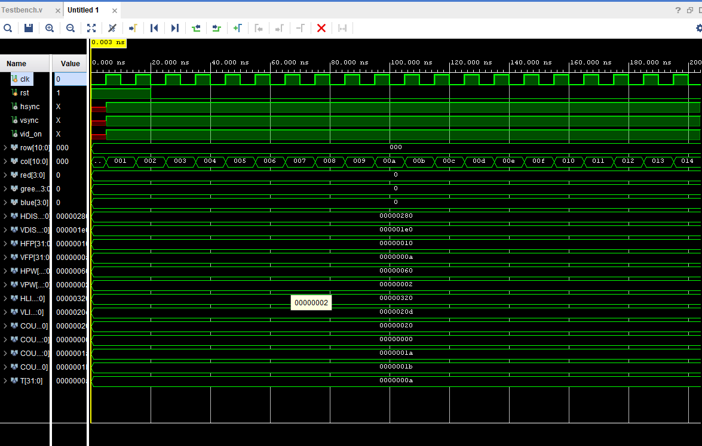
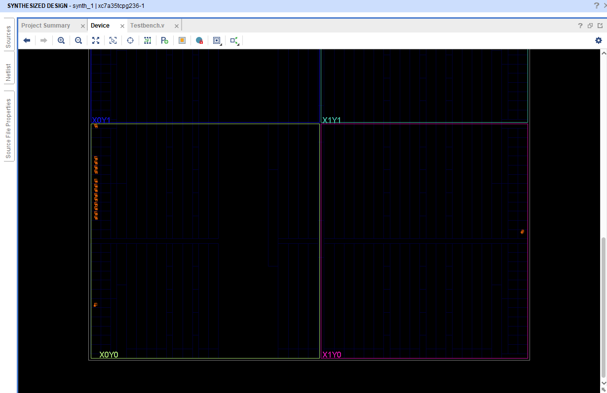
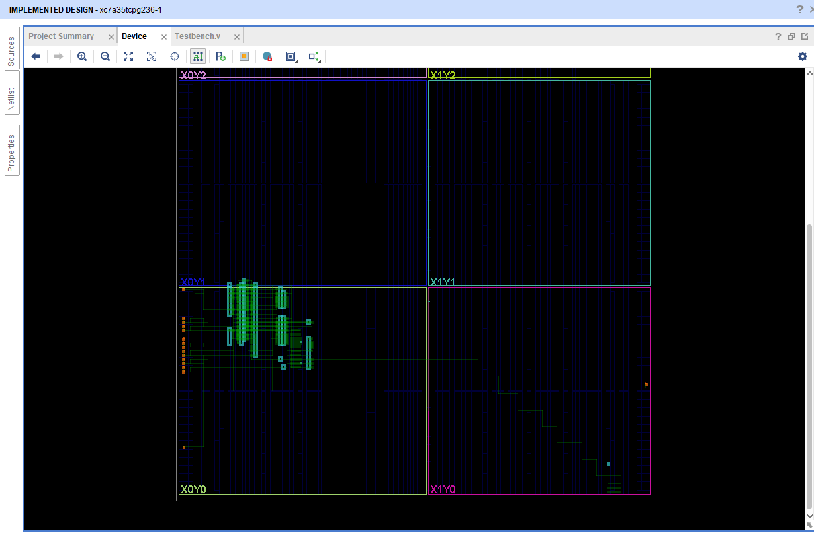
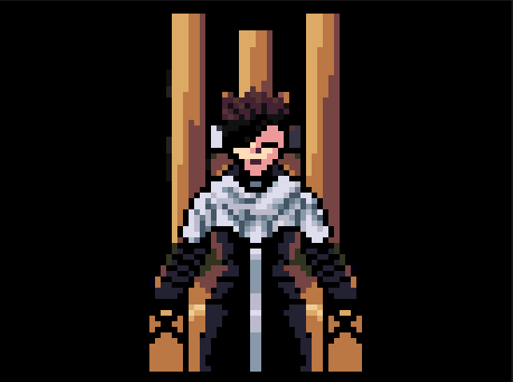
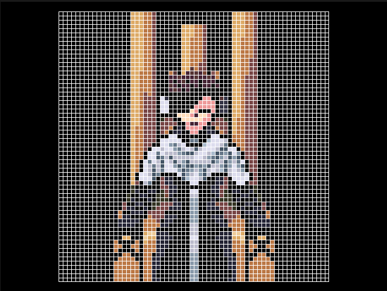

This is my System-on-Chip Design & Verification mini project blog. it involves manipulationg code to display shaped, colours or images onto a screen from the Basys3 Portal to the Vivado Design Suite board.

I have made my first entry here at 16:00 on 21/10/26.

<video width="100%" controls autoplay loop muted playsinline>
  <source src="https://basedalgerianrin.github.io/fpga-vga-verilog/docs/assets/images/DemoAnimation.mp4" type="video/mp4">
  <a href="https://basedalgerianrin.github.io/fpga-vga-verilog/docs/assets/images/DemoAnimation.mp4">Watch the demo video</a>
</video>

### **Project Set-Up**

Board info:  Artix-7 xc7a35tcpg236-1 on the Basys 3.
Design Sources: 
- VGATop.v 
- VGASync.v
- VGAColourStripes.v
Constraints:
- Basys3_Master.xdc
Clock:
- clk_wiz_0
Sim Sources:
- Testbench
- VGATop.v

## **My VGA Design Edit**

My project is a recreation of a pixel art using Image ROM method. It utilizes a row by row approach to color in certain blocks of pixels. Firstly is to draw in and color the pixels, later there will be a small animation of the art of a purple outline emitions. keeping everyhting simple since this is a relitively large art.

There are 3 design sources, VGATop.v, VGASync.v, and a colour-generator module, and a Clocking Wizard IP block (clk_wiz_0), and a Testbench.
The Basys3_Master.xdc is a constraints file and maps the top-level ports to board pins.
clock is on W5, reset is on V17, and the remaining pins carry HSync, VSync and four bits each of red, green and blue.

The design flow is: write or edit the Verilog, simulate it, synthesise, implement, generate the bitstream, then program the board.

### **Code Adaptation**

The main change is in VGAColourStripes.v (the module is still named ColourStripes). The
image is stored as a case statement with 64 entries. Each entry is one 768-bit row: 64 pixels ×
12 bits. Each pixel is therefore three hex digits in red, green, blue order, with the leftmost pixel
in the top bits. The whole image is 49,152 bits. VGATop now instantiates this module, passes it 
row and col, and clocks it with the 25 MHz pixel clock.
3
Each image pixel is drawn as a 7 × 7 block, making a 448 × 448 picture. A scale of 8 would
need 512 lines, which is more than the 480 available. The picture is centred, covering columns
96 to 543 and rows 16 to 463. in_image is true only inside that area; everywhere else is black.
### **Simulation**

A testbench replaces the physical board, it generates a clock, holds reset high for the first two falling clock edges, and instantiates the modules so their signals can be inspected. The colour-cycle testbench shrinks the timing values. This lets complete frames and all eight colour states appear within a few hundred nanoseconds instead of several seconds.

Testbench waveform shows the first 200 nanoseconds of the simulation. The clock has a 10ns peroid and the reset is high for the first 20ns then goes low for the remaining peroid. hsync, vsync and vid_on signals go high for the first rising edge of the clock. they remain high after that.

### **Synthesis**

The Synthesis schematic shows three main blocks: a clock, a VGA timing block and an image block. The clock drives the other two. The timing block controls the screen position and sync signals, while the image block outputs the colours. After implementation, the logic sits mostly in one small area of the chip.

 It used 441 LUTs, 36 flip-flops, 2 DSP slices, 16 I/O pins and no Block RAM. It also used 1 clock manager and 2 global clock buffers. It met all timing constraints on the 25 MHz pixel clock, with 26.561 ns of setup slack and 0.121 ns of hold slack. Estimated power use was 0.191 W.

### **Demonstration**

The design running from the Basys 3 board, displayed on a VGA monitor, is shown below. Each
of the 64 × 64 image pixels appears as a 7 × 7 block, centred on a black background.
a clock ticks at 25MHz and every tick a purple aura colour emits the following sequence: 

lavender -> light purple -> deep peurple. Video at the top demonstrates this live.

Here is a view of the division of the pixel blocks that are coloured inside of the white borders. the border grid was reemoved in the grand finale.
